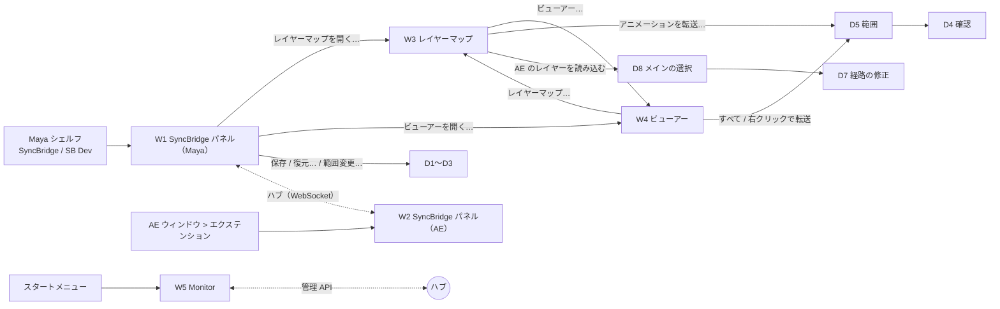
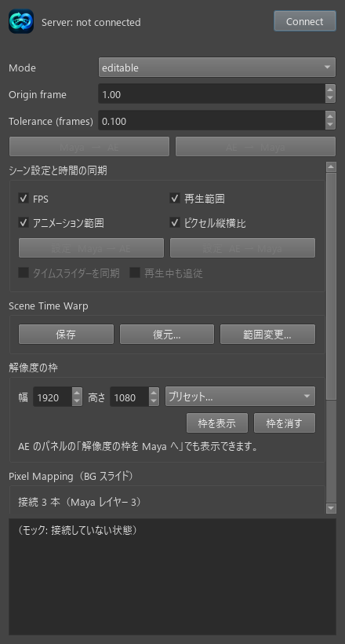
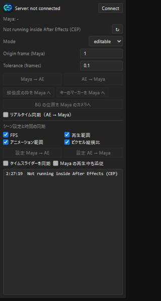
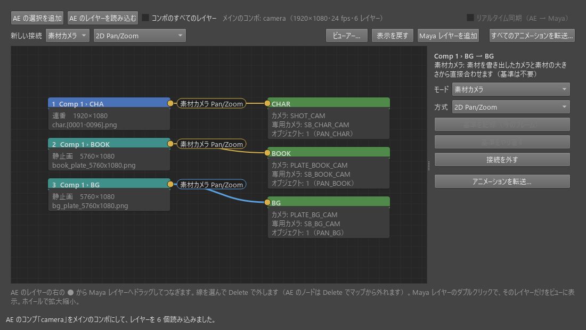
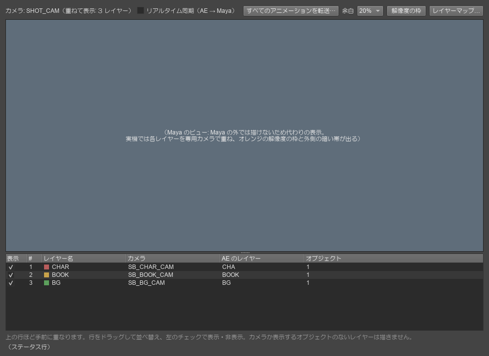
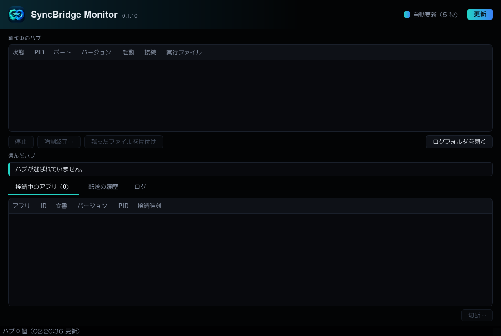
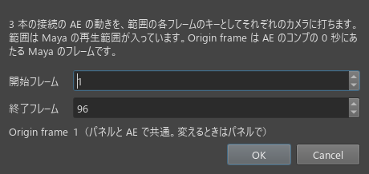
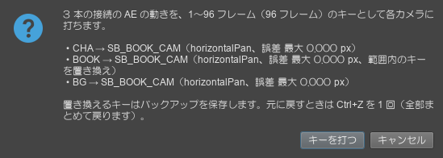
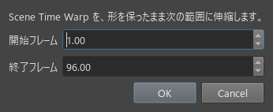
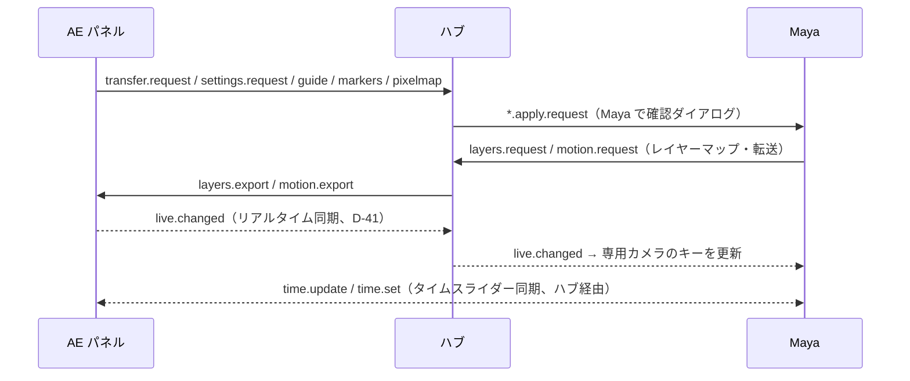

# SyncBridge UI/UX 現状調査（2026-10-27）

**調査のみ。UI の変更・リファクタリングはしていない。**
対象: `main` + 未コミットの作業（リアルタイム同期 D-41、テスト版 0.1.10）。

**根拠の表記**

| 表記 | 意味 |
|---|---|
| ✔ | ソースコードで確認した事実（ファイル・行・関数を併記） |
| 🧪 | 実機（Maya / AE の GUI）で利用者が確認したこと |
| 💭 | 推測（コードからの推定。実機での確認はしていない） |

**画面の画像について（`docs/ui_audit/`）**
この環境では Maya と AE の GUI を撮れないため、**実機のスクリーンショットはない**。代わりに、実際の UI のコード（同じクラス・
同じ HTML）を Maya・AE の外で描いた**モック**を載せる。

| 画像 | 描き方 | 実機との違い |
|---|---|---|
| W1 パネル・W3 レイヤーマップ・D3・D5 | mayapy（Maya 2024）で実際のクラスをオフスクリーンで描画。データはテスト用の横 PAN のシーン | Maya のテーマの代わりに暗い Fusion の配色。未接続の状態 |
| D4 確認 | `.venv` の PySide6 で `dialogs.build_question`（mayapy では QMessageBox を描くと落ちるため）。本文は `motion.describe_all` が作った文 | 例のデータのため、カメラ名がすべて同じ |
| W4 ビューアー | 上のバーとレイヤー一覧は実際の部品（`make_live_check`、`LayerStackList`）と同じ文言。**Maya のビューは Maya の外で描けないので代わりの表示** | ビューの中身・枠・HUD は写っていない |
| W5 Monitor | `.venv` で実際の `MonitorWindow` を描画 | この PC で動いているハブがないため一覧は空 |
| W2 AE パネル | ブラウザで実際の `panel/index.html` を幅 320 の枠で表示 | AE の外なので「Not running inside After Effects」。未接続 |

ASCII の配置図はコードからの推測（画像と合わせて見る）。

パスの略記: `syncbridge_maya/` = `maya_plugin/scripts/syncbridge_maya/`

---

## 1. UI 一覧

### 1.1 ウィンドウ・パネル

| # | 画面 | 種類 | 役割 | 起動方法 | 主なソース |
|---|---|---|---|---|---|
| W1 | **SyncBridge パネル**（Maya） | `QDialog`（Qt.Tool、440×820、最小幅 360） | Maya 側の入口。接続、タイムワープの転送、シーン設定、時間の同期、解像度の枠、Pixel Mapping への入口、マーカー | シェルフ「SyncBridge」タブのボタン、`drag_to_maya_SyncBridge.py`、開発時は「SB Dev」 | `syncbridge_maya/ui.py` `SyncBridgePanel`（:51）、`show()`（:735） |
| W2 | **SyncBridge パネル**（AE） | CEP パネル（320×460、最小 260×300） | AE 側の入口。接続、タイムワープの転送、解像度の枠・マーカー・BG の位置を Maya へ、リアルタイム同期、シーン設定、時間の同期 | AE「ウィンドウ」→「エクステンション」→「SyncBridge」。開くと自動で 1 回接続を試す | `after_effects/panel/index.html`、`js/main.js`、`js/sbclient.js`、`CSXS/manifest.xml` |
| W3 | **レイヤーマップ** | `QWidget`（Window、1100×620） | AE のレイヤーと Maya レイヤーをノードでつなぐ。Maya レイヤー・専用カメラ・接続の編集、アニメーション転送、リアルタイム同期 | W1「レイヤーマップを開く…」、W4「レイヤーマップ…」 | `layer_map_window.py` `LayerMapWindow`、`layer_map_view.py` `LayerMapEditor` / `LayerMapView` / `LayerMapScene` / `Node` / `Wire` |
| W4 | **ビューアー** | `QWidget`（Window、960×720）＋埋め込みの modelPanel | Maya レイヤーをそれぞれの専用カメラで重ねて表示する。並べ替え、表示切替、枠、余白、アニメーション転送、リアルタイム同期 | W1「ビューアーを開く…」、W3「ビューアー…」 | `viewer_window.py` `ViewerWindow`、`layer_stack_view.py` `LayerStackList`、`plug-ins/syncbridge_layer_stack.py` |
| W5 | **SyncBridge Monitor** | `QMainWindow`（1100×740） | ハブの一覧、接続中のアプリ、転送の履歴、ログ。停止・強制終了・切断 | スタートメニュー「SyncBridge Monitor」（`SyncBridge.exe`）、開発時は `syncbridge-monitor.cmd` | `src/syncbridge/monitor/window.py` `MonitorWindow`、`model.py` |
| W6 | Maya のビューの「表示」メニューの 2 項目 | Maya 標準のメニュー（プラグインの表示フィルタ） | 解像度の枠・キーのマーカーの表示の切り替え | 各ビューの「表示」メニュー | `plug-ins/syncbridge_guide.py:452-469`（D-20） |
| W7 | インストーラー | Install.bat・Uninstall.bat、メッセージボックス | 導入と削除 | zip を展開して実行 | `packaging/installer/install.ps1`、`uninstall.ps1`、`README_SyncBridge.txt` |

（Phase 0 の旧スクリプト `after_effects/jsx/syncbridge_ae.jsx` の ScriptUI ダイアログも残っている。現在の利用の流れには含まれない。）

### 1.2 ダイアログ

| # | ダイアログ | 種類 | 出る操作 | ソース |
|---|---|---|---|---|
| D1 | 保存する名前 | `QInputDialog.getText` | W1「保存」 | `ui.py:377` |
| D2 | 復元 | `RestoreDialog`（モーダル、最小幅 560） | W1「復元…」 | `ui.py:685` |
| D3 | 範囲変更 | `RangeDialog` | W1「範囲変更…」 | `ui.py:657` |
| D4 | 適用の確認（Maya） | `dialogs.ask`（QMessageBox。既定は OK、Esc でキャンセル、常に最前面） | AE → Maya のタイムワープ、復元、範囲変更、設定 AE → Maya、アニメーション転送 | `dialogs.py:38-62`、`exchange.py:101`、`scene_settings.py:64`、`motion.py:211` |
| D5 | アニメーション転送の範囲 | `MotionDialog`（最小幅 460） | W3・W4 の転送 | `motion_transfer.py:33` |
| D6 | Maya レイヤーの削除の確認 | `QMessageBox.question` | W3「このレイヤーを削除」 | `layer_map_window.py:393` |
| D7 | 経路の修正の確認 | `QMessageBox.question` | W3「AE のレイヤーを読み込む」 | `layer_map_window.py:242` |
| D8 | メインのコンポの選択 | `QInputDialog.getItem` | W3「AE のレイヤーを読み込む」でプリコンポを読んだとき | `layer_map_window.py:231` |
| D9 | AE の適用の確認（タイムワープ） | JSX の `confirm`（**英語**） | Maya → AE のタイムワープ。fps や伸縮が違うときは追加の confirm | `syncbridge_ae_lib.jsxinc:323-336` |
| D10 | AE の適用の確認（シーン設定） | JSX の `confirm`（日本語。文はハブが作る） | 設定 Maya → AE | `syncbridge_cep_host.jsx:137` |
| D11 | モニターの確認 | `QMessageBox.question`（既定は「いいえ」） | 停止・強制終了・片付け・切断 | `monitor/window.py:428-460` |
| D12 | 範囲の入力エラー | `QMessageBox.warning` | D2・D3・D5 で終了が開始より前のとき | `ui.py:680,730`、`motion_transfer.py:64` |

---

## 2. 画面構成図

### 2.1 画面の呼び出し関係



- ✔ W3・W4 は `show()` を呼ぶと、既存のウィンドウを閉じて作り直す（`layer_map_window.py:430-440`、`viewer_window.py:267-277`）。
  別の画面から開くと、その画面の一時状態（ノードの位置、「コンポのすべてのレイヤー」など）が消える。
- ✔ W3 と W4 は `service.announce("layer_map")` と scriptJob（Undo / Redo / SceneOpened）で互いの変更を反映する。

### 2.2 W1 SyncBridge パネル（Maya）（コードからの推測）



モック（実際の `SyncBridgePanel` を 440×820 で描画）。この大きさでは「Pixel Mapping」欄の途中でスクロールが要り、レイヤーマップ・ビューアーを開くボタンと「AE のキーのマーカー」欄は見えない。

```
+-----------------------------------------------+
| SyncBridge 0.1.x                         [x]  |
| [logo] Server: not connected       [Connect]  |
| After Effects: not connected                  |
| Mode               [editable      v]          |
| Origin frame       [   1001.00   ]            |
| Tolerance (frames) [     0.100   ]            |
| [ Maya  →  AE ]      [ AE  →  Maya ]          |
|+-- スクロール領域 ---------------------------+|
|| シーン設定と時間の同期                      ||
||  [x]FPS [x]再生範囲 [x]アニメーション範囲 [x]ピクセル縦横比
||  [設定  Maya → AE]  [設定  AE → Maya]       ||
||  [ ]タイムスライダーを同期 [ ]再生中も追従  ||
|| Scene Time Warp                             ||
||  [保存] [復元…] [範囲変更…]                 ||
|| 解像度の枠                                  ||
||  幅[1920] 高さ[1080] [プリセット… v]        ||
||  [枠を表示] [枠を消す]                      ||
|| Pixel Mapping（BG スライド）                ||
||  接続 N 本（Maya レイヤー N）…              ||
||  [レイヤーマップを開く…] [ビューアーを開く…]||
|| AE のキーのマーカー                         ||
||  …                       [マーカーを消す]   ||
|+---------------------------------------------+|
| ログ（時刻なし、最大 500 行）                 |
+-----------------------------------------------+
```

### 2.3 W2 SyncBridge パネル（AE）（コードからの推測）



モック（実際の HTML をブラウザで幅 320 で表示。AE の外のため未接続・ボタンは無効）。

```
+------------------------------------------+
|[logo] Server: not connected   [Connect]  |
| Maya: -                                  |
| Layer: -                            [↻]  |
| Mode                     [editable  v]   |
| Origin frame (Maya)      [     1   ]     |
| Tolerance (frames)       [   0.1   ]     |
| [   Maya → AE    ] [   AE → Maya    ]    |
| [解像度の枠を Maya へ][キーのマーカーを Maya へ]|
| [      BG の位置を Maya のカメラへ     ]  |
| [ ] リアルタイム同期（AE → Maya）        |
| シーン設定と時間の同期                     |
| [x] FPS [x] 再生範囲 [x] アニメーション範囲 [x] ピクセル縦横比
| [ 設定 Maya → AE ] [ 設定 AE → Maya ]    |
| [ ] タイムスライダーを同期 [ ] Maya の再生中も追従|
| ログ（時刻つき、最大 300 行）              |
+------------------------------------------+
```

### 2.4 W3 レイヤーマップ（コードからの推測）



モック（実際の `LayerMapWindow`。接続を選んだときのインスペクター。素材カメラモードなので基準の 2 つのボタンは無効）。
ほかの状態: [全体](ui_audit/w3_layer_map.png)、[Maya レイヤーを選択](ui_audit/w3_layer_map_maya_layer.png)、[AE ノードを選択](ui_audit/w3_layer_map_ae_node.png)。

```
+--------------------------------------------------------------------------------------------+
|[AE の選択を追加][AE のレイヤーを読み込む][ ]コンポのすべてのレイヤー  メインのコンポ: …   |
|                                                           [ ]リアルタイム同期（AE → Maya） |
|新しい接続 [素材カメラ v][2D Pan/Zoom v]   [ビューアー…][表示を戻す][Maya レイヤーを追加]   |
|                                                            [すべてのアニメーションを転送…] |
+--------------------------------------------------------------+-----------------------------+
| ノードエディター（中ボタンで移動、ホイールで拡大縮小）          | インスペクター（4 ページ）  |
|  [AE ノード ●]==== 素材カメラ Pan/Zoom ====[● Maya レイヤー]   |  空 / AE / Maya / 接続      |
+--------------------------------------------------------------+-----------------------------+
| ヒント（灰色）                                                                              |
| ステータス行（エラーはオレンジ）                                                            |
+--------------------------------------------------------------------------------------------+
```

インスペクター（✔ `layer_map_view.py:494-585`）:

| ページ | 中身 |
|---|---|
| AE | 種類・ソース・サイズ・イン/アウト・3D・親・キーの表、「マップから外す」 |
| Maya レイヤー | 名前、カメラ（元 → 専用）、「選択中のカメラにする」、「このレイヤーで見る」、表示するオブジェクトの一覧、「選択中を追加」「外す」「Maya で選択」、「このレイヤーを削除」 |
| 接続 | 説明（AE › … → レイヤー、基準）、モード、方式、「基準を記録（今のフレーム）」、「基準をやり直す」、「接続を外す」、「アニメーションを転送…」 |

### 2.5 W4 ビューアー（コードからの推測）



モック（上のバーと一覧は実際の部品。Maya のビューは代わりの表示）。右クリックのメニュー: [画像](ui_audit/w4_viewer_menu.png)。

```
+------------------------------------------------------------------------------------------+
|カメラ: SHOT_CAM（重ねて表示: N レイヤー） [ ]リアルタイム同期 [すべてのアニメーションを転送…]|
|                                        余白 [20% v] [解像度の枠] [レイヤーマップ…]       |
+------------------------------------------------------------------------------------------+
| Maya のビュー（modelPanel のメニューバー付き。各レイヤーを専用カメラで描いて重ねる。      |
|   オレンジの枠、枠の外は半透明の黒、左上にラベル）                                        |
+================================ スプリッター (3:1) ======================================+
| 表示 | # | レイヤー名 | カメラ（専用）| AE のレイヤー | オブジェクト   ← 行をドラッグで並べ替え|
|      |   |            |               |               |    右クリック「このレイヤーの転送…」|
| ヒント（灰色）                                                                           |
| ステータス行                                                                             |
+------------------------------------------------------------------------------------------+
```

### 2.6 W5 Monitor（コードからの推測）



モック（実際の `MonitorWindow`。ハブが動いていない状態）。

```
+--------------------------------------------------------------------------+
|[logo] SyncBridge Monitor 0.1.x          [x] 自動更新（5 秒）  [ 更新 ]    |
| 動作中のハブ: 状態 | PID | ポート | バージョン | 起動 | 接続 | 実行ファイル |
| [停止] [強制終了…] [残ったファイルを片付け]          [ログフォルダを開く]   |
|=========================== スプリッター ==================================|
| 選んだハブ: [接続中のアプリ（N）][転送の履歴][ログ]                        |
|                                                              [切断…]     |
| ステータスバー                                                            |
+--------------------------------------------------------------------------+
```

---

### 2.7 ダイアログ（モック）

| D5 アニメーション転送の範囲 | D4 キーを打つ確認 | D3 範囲変更 |
|---|---|---|
|  |  |  |

---

## 3. 各画面の詳細仕様

### 3.1 W1 SyncBridge パネル（Maya）

| 部品 | 処理（✔） | 初期値・保存先（✔） | 有効条件（✔ `ui.py` `refresh()` :604-615） |
|---|---|---|---|
| Connect / Disconnect | `toggle_connection`（:258）。未接続なら待ちカーソルを出して `service.connect(start_server=True)`（ハブを自動起動）。切断は確認なし | — | 常に有効 |
| Mode（editable / precision） | 転送のオプション | editable。保存しない | 常に有効 |
| Origin frame | 変わるたびに `service.set_time_origin` → シーンの `syncBridgeTiming.originFrame` に書き、`timing.set` を送る（undo の対象外） | シーン（なければ再生範囲の開始）。AE と共有 | 常に有効 |
| Tolerance (frames) | 転送のオプション | 0.1。保存しない | 常に有効 |
| Maya → AE / AE → Maya | `transfer()` → `service.send_to_ae` / `receive_from_ae` | — | 接続中・AE がいる・処理中でない |
| 設定の 4 項目 | `save_setting_items` | 初回は全部オン。optionVar `syncBridgeSettingsItems` | 常に有効 |
| 設定 Maya → AE / AE → Maya | `send_settings`（:299）。0 項目ならログを出して終わる | — | 接続中・AE がいる・処理中でない |
| タイムスライダーを同期 / 再生中も追従 | `service.set_time_sync` | ハブの状態。保存しない | 接続中 |
| 保存 / 復元… / 範囲変更… | `save_warp` / `restore_warp` / `retime_warp`（:376-417） | `<userAppDir>/SyncBridge/snapshots/`、バックアップは `backups/` | 常に有効（未接続でも可） |
| 幅・高さ・プリセット・枠を表示・枠を消す | `comp_guide.show_size` / `clear` | 大きさは optionVar `syncBridgeGuideSize`（**表示に成功したときだけ**保存） | 常に有効 |
| レイヤーマップを開く… / ビューアーを開く… | 各 `show()` | — | 常に有効 |
| マーカーを消す | `key_markers.clear()`（確認なし、Ctrl+Z 可） | シーンの `syncBridgeKeyMarkers` | マーカーがあるとき |

**表示**（✔）
- ログ欄に出す（**時刻なし**、`ui.py:617`）。同じ内容がスクリプトエディタにも print されることがある（`service.py`、`exchange.py`）。
- ログの言語: 接続とタイムワープの転送まわりは**英語**（`connecting…`、`Undo once to revert.` など、`ui.py:262-287,489-519`）。ほかは日本語。

### 3.2 W2 SyncBridge パネル（AE）

| 部品 | 処理（✔ `main.js`、`sbclient.js`） | 初期値・保存先 | 有効条件（✔ `refresh()` :201-227） |
|---|---|---|---|
| Connect | `connect()`: JSX の `readSession` でセッションファイルを読み、WebSocket で `hello`。**AE はハブを起動しない**。パネルを開くと自動で 1 回試す（:434-438）。自動の再接続はない | — | 常に有効 |
| Layer: … / ↻ | 3 秒ごとと ↻ で `info` を読み、選択中のレイヤーを表示 | — | 常に有効 |
| Mode / Origin frame (Maya) / Tolerance (frames) | 転送のオプション。Origin は `timing.set` で Maya と共有 | localStorage `syncbridge.panel.options`（Mode・Tolerance は AE だけが保存し、Maya とは共有しない。Maya 側は保存しない） | 常に有効 |
| Maya → AE / AE → Maya | `transfer.request` | — | 接続中・Maya がいる・レイヤーを 1 つ選択・タイムリマップ可・処理中でない |
| 解像度の枠を Maya へ | `compInfo` → `guide.request` | — | 接続中・Maya・コンポあり |
| キーのマーカーを Maya へ | `exportSelected` → `markers.request` | — | 転送と同じ |
| BG の位置を Maya のカメラへ | `pixelMapInfo` → `pixelmap.request` | — | 接続中・Maya・レイヤーを選択 |
| リアルタイム同期（AE → Maya） | `live.sync`。オンの間は 0.4 秒ごとに `layersFingerprint` | ハブと共有。保存しない | 接続中・Maya がいる |
| 設定の 4 項目・設定 Maya → AE / AE → Maya | `settings.request` | localStorage | 接続中・Maya・コンポあり |
| タイムスライダーを同期 / Maya の再生中も追従 | `time.sync` | ハブと共有 | 接続中 |

**表示**（✔）
- ログ欄（**時刻つき**、300 行）と、上の状態の文字だけ。HTML 側の alert はない。
- AE 側のダイアログは JSX の confirm だけ（D9 は英語、D10 は日本語）。
- 接続とタイムワープまわりのログは**英語**、ほかは日本語。
- JSX のエラーはコードを `MESSAGES` で日本語にする。コードがないものは英語の原文のまま。

### 3.3 W3 レイヤーマップ

**ツールバー 1 段目**（✔ `layer_map_view.py:424-452`）

| 部品 | 処理 | 保存先 |
|---|---|---|
| AE の選択を追加 | `add_ae_selection`: メインのコンポの一覧を読み、AE で選択中のレイヤーを経路ごと `ae_shown` に追加 | シーンの `syncBridgeLayerMappings` |
| AE のレイヤーを読み込む | `load_ae_layers`: AE で開いているコンポをメインにする。プリコンポなら D8、古い接続があれば D7 | 同上（`main_comp`） |
| コンポのすべてのレイヤー | 一時的にすべて表示 | メモリのみ |
| メインのコンポの表示 | ラベル | — |
| リアルタイム同期（AE → Maya） | `service.set_live_sync` | ハブ |

**ツールバー 2 段目**（✔ `layer_map_view.py:435-451`）

| 部品 | 処理 | 保存先 |
|---|---|---|
| 新しい接続: モード（素材カメラ / 相対） | `set_defaults(mode=)` | optionVar `syncBridgePixelMapMode` |
| 新しい接続: 方式（4 種類） | `set_defaults(method=)` | optionVar `syncBridgePixelMapMethod` |
| ビューアー… | ビューアーを開く（作り直し） | — |
| 表示を戻す | Isolate Select を外す | — |
| Maya レイヤーを追加 | 選択中のカメラ・オブジェクトで追加（**ツールチップなし**） | シーン |
| すべてのアニメーションを転送… | `MotionTransfer.all`（D5 → D4） | — |

**マウスとキー**（✔）

| 操作 | 結果 |
|---|---|
| AE ノードの ● から Maya ノードへドラッグ | つなぐ |
| Maya ノードをダブルクリック | このレイヤーで見る |
| 中ボタンのドラッグ | 画面の移動 |
| ホイール | 拡大縮小（0.3〜3 倍） |
| Delete / Backspace | 線を外す、または AE ノードをマップから外す |

**有効条件**（✔）

| 部品 | 有効になる条件 |
|---|---|
| すべてのアニメーションを転送 | 接続が 1 本以上 |
| マップから外す | つながっていないとき |
| 基準の 2 つのボタン | 相対モードのとき |
| リアルタイム同期 | 接続中 |
| ほかのインスペクターのボタン | 常に有効 |

**表示**（✔）
- 下端のステータス行（エラーはオレンジ）に出す。毎回 print もする。
- 進捗は「（i / n）」のような文で出す。

### 3.4 W4 ビューアー

| 部品 | 処理（✔ `viewer_window.py`、`layer_stack_view.py`） | 保存先 |
|---|---|---|
| カメラ表示 | 表示に関係なく、一番上のレイヤーの元のカメラ（`core.layer_mapping.view_camera_uuid`） | — |
| リアルタイム同期 | W3 と同じスイッチ（`make_live_check` を共有） | ハブ |
| すべてのアニメーションを転送… | `MotionTransfer.all`。**常に有効**（接続がなければ押したあとに知らせる） | — |
| 余白（なし / 10% / 20% / 30%） | `layer_stack.set_margin` | optionVar `syncBridgeViewerMargin`（初期 20%） |
| 解像度の枠 | 一番上のレイヤーの元のカメラに枠を出す。**消すボタンはない** | optionVar `syncBridgeGuideSize` |
| レイヤーマップ… | レイヤーマップを開く（作り直し） | — |
| 一覧: 表示のチェック | `set_layer_visible`（undo 1 回）。描き直しは 30 ms にまとめる | シーン |
| 一覧: 行のドラッグ | `reorder_layers`（undo 1 回） | シーン |
| 一覧: 右クリック | 「このレイヤーのアニメーションを転送…」（AE の列が「―」なら無効） | — |
| 開いたとき | 古い専用カメラの Overscan を、確認なしで 1.0 に直す（undo 1 回） | — |

### 3.5 W5 Monitor

| 部品 | 処理（✔ `monitor/window.py`） | 有効条件 |
|---|---|---|
| 自動更新（5 秒）・更新 | 別スレッドで `hubs.clean_stale_files()` と `discover()`。**自動更新のたびに、停止済みのハブのファイルを確認なしで消す** | 常に有効 |
| 停止 | `POST shutdown`（D11） | 正常に動いていて、管理 API があるとき |
| 強制終了… | `hubs.force_kill`（D11） | SyncBridge のハブだと確認できたとき |
| 残ったファイルを片付け | D11 | 停止済みのとき |
| ログフォルダを開く | `os.startfile` | 常に有効 |
| タブ: 接続中のアプリ・転送の履歴・ログ | 管理 API と `/admin/events` で差分を受け取る | — |
| 切断… | D11 | アプリの行を選んでいるとき |

設定（自動更新、ログのレベル、ウィンドウの大きさ）は**保存しない**（QSettings を使っていない）。

---

## 4. 主要ワークフロー

ステップ数は、利用者がクリック・選択・入力する回数（Maya / AE の通常の操作を含む）。確認ダイアログの OK も 1 と数える。
括弧内は条件つきで増えるステップ。

| # | ワークフロー | 手順 | ステップ数 | 根拠 |
|---|---|---|---|---|
| 1 | **Maya と AE の接続** | ① Maya のシェルフのボタンでパネルを開く ② Connect（ハブが自動起動）③ AE で「ウィンドウ > エクステンション > SyncBridge」（開くと自動で接続を試す）④（ハブが後から起動した場合）AE の Connect | 3〜4（AE のメニューを 3 クリックと数えると 5〜6） | ✔ `ui.py:258`、`main.js:434-438`。AE は自動で再接続しない |
| 2a | **タイムワープ Maya → AE** | ① AE でレイヤーを 1 つ選ぶ ② Mode・Origin を確認 ③「Maya → AE」（どちらのパネルからでも）④ AE の confirm で OK（⑤ fps・伸縮が違えば追加の confirm） | 3〜5 | ✔ `ae_lib.jsxinc:323-336` |
| 2b | **タイムワープ AE → Maya** | ① AE でレイヤーを選ぶ ②「AE → Maya」③ Maya の確認で「適用」 | 3 | ✔ `exchange.py:101` |
| 3 | **タイムスライダー同期** | ①「タイムスライダーを同期」をオン（どちらでも）（② 再生中も追従） | 1〜2 | ✔ |
| 4 | **AE → Maya の Pixel Mapping（1 回送信）** | 前提: 6 のレイヤーマップで接続済み。① AE で BG のレイヤーを選ぶ ②「BG の位置を Maya のカメラへ」 | 2 | ✔ `main.js` `sendPixelMap`、`pixel_mapping.apply_from_ae`（確認なし） |
| 5 | **Layer Mapping の作成・編集**（1 レイヤーぶん） | ① パネル「レイヤーマップを開く…」② AE でメインのコンポを開く ③「AE のレイヤーを読み込む」（④ D8 で外側を選ぶ）（⑤ D7 で「はい」）⑥ AE でプリコンポを開く ⑦ AE でレイヤーを選ぶ ⑧「AE の選択を追加」⑨ Maya でカメラとオブジェクトを選ぶ ⑩「Maya レイヤーを追加」⑪ 新しい接続のモードと方式を選ぶ ⑫ ● から Maya ノードへドラッグ | 初回 10〜12。2 レイヤー目からは ⑥〜⑩・⑫ の 5〜6 | ✔ `layer_map_window.py`、`layer_map_view.py` |
| 5' | （相対モードのとき）基準 | ⑬ Maya と AE の見え方を合わせる ⑭ 線を選ぶ ⑮「基準を記録（今のフレーム）」 | +3 | ✔ |
| 5'' | 編集 | 名前: インスペクターで入力して Enter。カメラ: Maya で選ぶ →「選択中のカメラにする」。オブジェクト: 選ぶ →「選択中を追加」。外す: 線を選んで Delete | 各 2〜3 | ✔ |
| 6 | **アニメーションの一括転送** | ①「すべてのアニメーションを転送…」（W3 か W4）② 範囲を確認して OK ③「キーを打つ」 | 3 | ✔ `motion_transfer.py`、`motion.py:211` |
| 6' | （リアルタイム同期）| ① スイッチをオン。以降は AE で動かすだけ（Maya での操作は 0） | 1 | ✔ D-41。🧪 実機は未確認 |
| 7 | **専用ビューアーの起動と操作** | ①「ビューアーを開く…」（②「解像度の枠」）（③ 余白を選ぶ）④ タイムラインを動かして見る | 1〜3 | ✔ |
| 8 | **ビューアーのレイヤー並べ替え** | ① 一覧の行をドラッグ。表示・非表示はチェックで 1 | 1 | ✔ `layer_stack_view.py` |
| 9 | **サーバーモニター** | ① スタートメニュー「SyncBridge Monitor」② ハブを選ぶ（最初は自動で先頭）③ タブを切り替える（④ 停止・切断と確認で +2） | 1〜4 | ✔ |

### 4.1 全体のデータの流れ（参考）



---

## 5. UX 上の課題候補

### 5.1 重複している操作

| 課題 | 根拠 | 種類 |
|---|---|---|
| 「すべてのアニメーションを転送…」が W3 と W4 にある（処理は同じ、ツールチップの文が違う） | ✔ `layer_map_view.py:418`、`viewer_window.py:73` | 事実 |
| リアルタイム同期のスイッチが W2・W3・W4 の 3 か所にある。**W1（メインパネル）にはない** | ✔ | 事実 |
| W3 と W4 が互いを開くボタンを持ち、開くと相手を作り直す（一時状態が消える） | ✔ `show()` | 事実 |
| 解像度の枠が W1（大きさを入力）、W2（コンポの大きさを送る）、W4（ボタン）、W6（表示メニュー）にある。W4 には消すボタンがない | ✔ | 事実 |
| Mode・Origin・Tolerance が W1 と W2 の両方にある。Origin は共有されるが、Mode と Tolerance は共有されない（AE は localStorage に保存、Maya は保存しない） | ✔ `ui.py`、`main.js:135-160` | 事実。食い違うと混乱する 💭 |
| 新しい接続のモード・方式（ツールバー）と、線ごとのモード・方式（インスペクター）の 2 か所がある | ✔ | 事実（役割は違う） |
| 「このレイヤーで見る」（普通のビューを Isolate）と、ビューアーの重ね表示の 2 系統がある | ✔ `layer_view.py`、`viewer_window.py` | 事実。使い分けが分かりにくい 💭 |
| 基準の記録が、W3「基準を記録（今のフレーム）」と、W2「BG の位置を Maya のカメラへ」の最初の送信の 2 経路 | ✔ | 事実 |

### 5.2 機能が分散している画面

| 課題 | 根拠 |
|---|---|
| Pixel Mapping 関係が W1（入口と要約）、W2（1 回送信・リアルタイム同期）、W3（設定と転送）、W4（確認と転送）に分かれる | ✔ |
| キーのマーカーは W2 から送り、W1 で消す。表示の切り替えは W6 | ✔ |
| タイムワープの保存・復元・範囲変更は W1 だけ。転送は W1 と W2 | ✔ |
| ハブの状態は W1・W2 の状態の文字と W5 に分かれ、W5 は別アプリ | ✔ |

### 5.3 確認ダイアログ

| 課題 | 根拠 | 種類 |
|---|---|---|
| アニメーション転送は「範囲（D5）」→「キーを打つ（D4）」の 2 回 | ✔ | 事実。1 画面にまとめられる余地 💭 |
| 「AE のレイヤーを読み込む」で D8 → D7 が続くことがある | ✔ | 事実（安全のための確認） |
| 一方で、確認なしで実行するものもある: BG の位置の 1 回送信、AE からの枠・マーカー、リアルタイム同期、ビューアーを開いたときの Overscan の修正、W5 の自動の片付け | ✔ | 事実。確認の基準が画面ごとに違う 💭 |
| AE 側の確認（D9）だけ英語 | ✔ `ae_lib.jsxinc:323-336` | 事実 |

### 5.4 操作の階層が深い部分

| 課題 | 根拠 | 種類 |
|---|---|---|
| プリコンポの中のレイヤーを出すには、AE でメインのコンポを開いて読む → プリコンポを開く → 選ぶ → 追加、と AE と Maya を行き来する | ✔ D-40 | 事実。利用者が一度間違えた（メインのコンポの誤認、2026-10-26）🧪 |
| 1 レイヤーをつなぐまでに 10〜12 ステップ（初回） | ✔ 4 章 | 事実 |
| 線の設定・基準・転送が、線を選んだときのインスペクターにしかない（ノードや線の右クリックメニューはない） | ✔ | 事実 |
| インスペクターは 1 つ選んだときだけ。複数の接続をまとめて変えられない | ✔ `layer_map_view.py:587` | 事実 |

### 5.5 状態表示が不足している部分

| 課題 | 根拠 | 種類 |
|---|---|---|
| W1 のログに時刻がない（W2 はある） | ✔ | 事実 |
| W1 の初期サイズ（440×820）では、レイヤーマップ・ビューアーを開くボタンとマーカーの欄がスクロールしないと見えない | ✔ `ui.py`（スクロール領域の伸縮比 3、ログ 1）、モック画像 | 事実（モックで確認。実機の表示倍率では変わる） |
| W1 にリアルタイム同期の状態が出ない | ✔ | 事実 |
| W2・W5 は切断のあと自動で再接続しない。W2 はハブが後から起動しても、Connect を押すまでつながらない | ✔ | 事実 |
| W4 の「すべてのアニメーションを転送…」は常に有効で、押してから「転送できる接続がありません」と知らせる（W3 は無効にしている） | ✔ | 事実 |
| リアルタイム同期が最後にいつ・何を反映したかは、ステータス行の最後の 1 行だけ。履歴はない | ✔ `live_sync.py` | 事実 |
| W2 の `panel.css` に `.ok` と `.warn` があるが使われていない。状態は色なしの文字だけ | ✔ | 事実 |
| W5 の自動の片付けは、何を消したか表示しない | ✔ | 事実 |

### 5.6 迷いやすい可能性がある操作（💭 推測）

| 課題 | 根拠 |
|---|---|
| 「AE のレイヤーを読み込む」は、押した瞬間に AE で開いているコンポを**メインのコンポにする**。名前から副作用が分かりにくい | ✔ 処理は事実。迷うかどうかは推測（実際に 1 回起きた）|
| 「新しい接続」の方式のツールチップに「相対モードで始まります」とあるが、隣でモードを選べ、既定は素材カメラ（古い説明が残っている） | ✔ `layer_map_view.py:413` |
| ビューアーの上の「カメラ」は元のカメラ、一覧の「カメラ」の列は専用カメラ | ✔ `viewer_window.py:167`、`layer_stack_view.py:80` |
| 「Maya レイヤー」が、Maya 標準のディスプレイレイヤーと混同されやすい | 推測 |
| 「表示」という語が、Isolate（このレイヤーで見る）、ビューアーの重ね表示のオン・オフ、AE の非表示レイヤーの 3 つを指す | ✔ |
| W2「Maya の再生中も追従」は、時間の同期がオフのときにチェックしても、3 秒後の `refresh` で外れる可能性がある | ✔ `main.js:221`、`sbclient.js:284-287`。挙動は推測 |
| エラーコード `no_layer_named` が「プリコンポではない」場面にも使われ、日本語の文と意味がずれる | ✔ `syncbridge_cep_host.jsx:303` |
| `no_server` の案内文が開発用の `syncbridge-server.cmd` を挙げている（配布版は `SyncServer.exe`、Maya の Connect で起動） | ✔ |

### 5.7 一貫性のない命名・ラベル（✔）

| 対象 | 揺れ |
|---|---|
| UI の言語 | 接続・転送の部品とログが英語（Connect、Server、Mode、Tolerance (frames)、`Undo once to revert.`）、ほかは日本語 |
| 矢印 | `Maya  →  AE`（W1、空白 2 つ）、`Maya → AE`（W2）、`設定  Maya → AE`、「リアルタイム同期（AE → Maya）」、モニターは「Maya → After Effects」 |
| サーバー | 「Server」（W1・W2）、「SyncBridge のサーバー」（文）、「ハブ」（W5・ドキュメント） |
| コンポ | 「コンポ」と「コンプ」が混在（`layer_map_view.py:782`、`layer_map_window.py:200,203`、`motion.py:168`、`ui.py:74,124` ほか） |
| 接続 | 「接続」（ボタン）、「線」（ツールチップ・ヒント）、「つなぐ」 |
| アニメーション | 「アニメーションを転送」（ボタン）、「動き」（文）、「キーを打つ」（確認のボタン） |
| 取り消し | 「元に戻すときは Ctrl+Z を 1 回」「取り消しは Ctrl+Z を 1 回」「Ctrl+Z で戻せます」「取り消しを 1 回」「Undo once to revert.」 |
| 原点 | 「Origin frame」「Origin frame (Maya)」「原点フレーム」 |
| 追従 | 「再生中も追従」（W1）と「Maya の再生中も追従」（W2） |
| ウィンドウ名 | 「SyncBridge レイヤーマップ」「SyncBridge - アニメーションを転送」「SyncBridge」、modelPanel は `SyncBridge Viewer` |
| 方式 | `2D Pan/Zoom` と `Pan/Zoom`、`Film Translate・Scale・Roll` と `FT+Scale+Roll`（線のラベル） |
| モード | 「新しい接続」に「絶対」がなく、線ごとのモードには「絶対」がある |

### 5.8 キーボード操作（✔）

| 画面 | 状況 |
|---|---|
| W1 | 独自のショートカットはない。QDialog なので Esc でパネルが閉じる・Enter で既定ボタンが押される可能性がある 💭 |
| W2 | 独自のショートカットはない（Tab の移動のみ 💭） |
| W3 | Delete / Backspace（線・AE ノードを外す）、名前欄の Enter のみ |
| W4 | なし（一覧のチェックの Space は Qt の標準 💭） |
| W5 | なし。アクセスキーもない |
| ダイアログ | D4 は Esc でキャンセル。ほかは Qt の標準 |

---

## 6. UI の重複・整理できそうな箇所（候補。決定ではない）

| # | 候補 | 関わる画面 |
|---|---|---|
| 1 | Pixel Mapping とレイヤーの作業を 1 つの画面にまとめる（レイヤーマップ + ビューアーの一覧 + 転送 + リアルタイム同期）。あるいは W3 と W4 を作り直さずに行き来する | W3, W4 |
| 2 | W1 を「接続と状態のハブ」にし、各機能をタブかセクションで整理する（時間の転送、シーン設定、レイヤー） | W1 |
| 3 | W1 と W2 で同じ機能の並び・名前・保存を揃える（Mode・Tolerance の共有、矢印、言語） | W1, W2 |
| 4 | 接続の状態表示を共通にする（ハブ・相手のアプリ・リアルタイム同期・時間の同期を、どの画面でも同じ形で） | W1〜W4 |
| 5 | 確認の方針を決めて揃える（確認するもの・しないもの、2 段の確認をまとめるか） | D4, D5, D7, D8, D9 |
| 6 | 用語集を作って文言を揃える（サーバー/ハブ、コンポ、接続、取り消しの言い方） | 全体 |
| 7 | 解像度の枠を 1 か所で管理する（表示・消す・大きさ） | W1, W2, W4, W6 |
| 8 | ノードや線の右クリックメニュー、複数選択での一括変更 | W3 |
| 9 | 英語のログ・確認（D9）を日本語に揃える | W1, W2, D9 |
| 10 | 自動の再接続、または接続切れのはっきりした表示 | W1, W2, W5 |

---

## 7. 改善検討のために追加で必要な情報

| 情報 | 理由 |
|---|---|
| **実機のスクリーンショット**（W1〜W5。Maya の表示倍率と、AE パネルをドッキングしたときの幅） | 本書の配置図はコードからの推測。実際の詰まり具合や、切れる文言が分からない |
| 普段の画面配置（同時に開くウィンドウ、モニターの枚数、Maya のレイアウト） | W3 と W4 を統合するか、ドッキングさせるかの判断 |
| 利用者の役割（アニメーター、撮影、TD）と、1 カット・1 日あたりの操作回数 | ステップ数を減らす優先順位 |
| よく使う機能・使わない機能（例: Mode・Tolerance を変えるか、Precision を使うか、絶対モードは要るか） | 画面から外せるものの判断 |
| 1 カットあたりのレイヤー数・接続の本数 | レイヤーマップの表示と一括操作の必要性 |
| 迷った・間違えた操作の記録（例: 2026-10-26 のメインのコンポの誤認） | 5.6 の推測の裏付け |
| リアルタイム同期の実機での体感（遅れ、AE の重さ） | 状態表示や操作の設計（H-AE-34） |
| ショートカットの要望（Maya・AE の既存の割り当てとの衝突） | 5.8 の対応 |
| 社内の Maya / AE の言語設定（英語版か日本語版か） | 英語の残し方と、Qt 標準ボタン（OK / Cancel）の扱い |

**モック画像:** `docs/ui_audit/`（冒頭の表のとおり、実際の UI のコードを Maya・AE の外で描いたもの。実機のスクリーンショットではない）。
